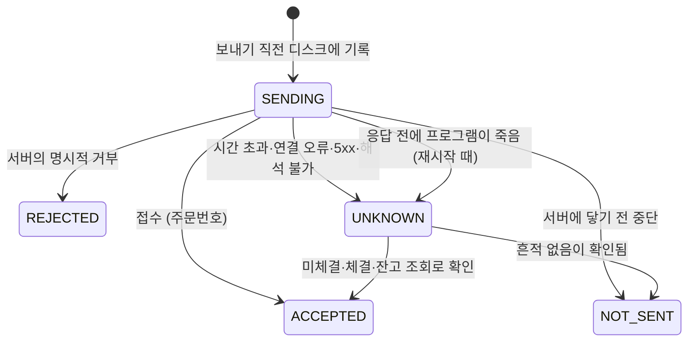

# 국내 주식 스윙: LightGBM 종목 선택 모델의 개발·검증 기록

**핵심:** 사전 등록(결과를 보기 전에 판정 기준 고정) · 국내 주식 스윙 · 무작위 200회 대조 · 전진 검증 등록 · 15:19 실매매 방식 통과 · 상주 실행 프로그램과 교차 리뷰

키움 REST API·한국거래소 일봉으로 LightGBM 종목 선택 모델을 만들고, **결과를 보기 전에 고정한 기준**으로 개발 구간(2022~2025)과 검증 구간(2026)을 판정한 기록입니다. 판정을 통과한 규칙을 그대로 돌리는 상주 실행 프로그램(`backtest_swing/live/`)도 함께 둡니다.

> 투자 권유가 아닙니다. 이 저장소의 숫자는 백테스트이며, 실제 매매 기록은 아직 없습니다 (모의투자 2026-10-26 시작).

## 이전 시도와 이번에 막은 것

이전 프로젝트 [ralss-daily](https://github.com/afafcalif/ralss-daily) (ETF 자동매매)는 끝난 뒤 코드 리뷰에서 결과 해석을 바꾸는 문제 5가지를 찾았습니다. 이번 프로젝트는 그 문제들을 처음부터 구조로 막는 데서 시작했습니다.

| 이전 문제 | 이번에 막은 방법 | 상태 |
|---|---|---|
| 1. 기본 모델이 가짜(Mock) 데이터로 학습됐을 가능성 | 데이터 출처 확인(실서버·한국거래소 공식 시세) | 백테스트 코드에 구현됨 |
| 2. 재학습한 모델이 실전에 반영되지 않음 | 재학습 모델은 경로·해시·고정 표본 예측값을 기록하고, 로드할 때마다 같은지 확인 (EXEC_SPEC 4장) | 실행 코드에 구현됨 (`live/model.py check`: 파일 SHA-256·특징 목록·고정 표본 예측), 모의투자에서 확인 중 |
| 3. 실행 엔진이 라벨과 다른 트레이드를 함 | **라벨 = 백테스트 = 실매매 규칙**: 라벨 계산과 평가가 같은 시뮬레이션 함수를 쓰고, 실매매 명세는 항목마다 "백테스트에서는 / 실매매에서는 / 차이와 대응"으로 적음 | 백테스트: 구현됨 / 실매매: 구현됨 — 동결 함수를 import 해 쓰고, 매일 저장한 스냅샷으로 동결 코드를 다시 돌려 상위 3 이 3/3 같은지 대조. 모의투자에서 확인 중 |
| 4. 횡단면 피처가 학습(전 시장)과 실전(ETF)에서 다른 집합으로 계산됨 | **학습 대상 = 매매 대상**: 같은 대상 조건·같은 함수로 같은 집합에서 계산 | 백테스트·실행 코드 모두 같은 함수 |
| 5. 익절 감시가 꺼진 채 운용된 것을 몰랐음 | **사전 등록 검증**: 규칙·판정 기준을 결과 전에 명세에 고정하고, 매일 대조 로그로 실행과 규칙의 차이를 기록 (EXEC_SPEC 5장) | 결과 전 기준 고정: 적용됨 (STAGE4/5_SPEC) / 매일 대조 로그: 구현됨 (하루 상태 파일 + summary 한 줄, 신규 매수를 쉰 이유 포함) |

## 단계별 기록

1. **지지·저항선 (1~3단계, 폐기).**
   - 직접 그린 차트 선을 정답으로 탐지기 274개 설정을 비교해 하나를 골랐습니다(B 다중 띠 2%, F1 0.543). 과적합 확인에서 앞 절반 1위가 뒤 절반 46위였습니다.
   - 그 선으로 만든 매매 규칙 36개 설정은 개발 구간에서 모두 비용 후 손실이었습니다(−0.16 ~ −1.23%).
   - 진단에서 선 신호는 같은 날 무작위 진입보다 1~60일 모든 구간에서 나빴습니다. 검증 구간은 돌리지 않았습니다.
2. **4단계 LightGBM (불합격).**
   - % 수익률 라벨로 (a)~(d)는 통과했습니다(상위 3 +1.312%, IC +0.317). 하지만 정답 섞기 검사(e)가 실패했습니다(섞은 모델 IC +0.044, 95% 범위가 0을 포함하지 않음).
   - 원인 진단:
     - 같은 날 평균을 뺀 뒤 ±30%로 잘라서 날짜별 평균이 남았습니다. 섞은 모델은 시장 특징으로 그 날짜 평균을 배웠습니다(SHAP 1~5위가 모두 시장 특징).
     - 20일선 거리 특징 하나의 IC(−0.369)가 모델보다 커서, 라벨이 청산 규칙 때문에 기계적으로 예측되고 있었습니다.
     - 수익 상위 10건이 전체 수익의 106%였습니다.
   - 판정 후 수정한 섞기 검사도 실패해서(IC +0.028) 멈췄습니다.
3. **5단계 수정.**
   - 라벨을 R 배수(손절폭 대비 수익)로 바꾸고, 자르기 → 같은 날 평균 빼기 순서로 고쳤습니다.
   - 정답 섞기는 순위 라벨을 10번 섞은 10개 모델의 분포로 판정합니다.
   - 지지·저항·수급 특징을 뺐습니다. 현재 시장 구분을 과거에 쓰던 미래 정보 특징(is_kospi)도 실행 전에 뺐습니다. 특징은 41개입니다.
   - 개발 구간 판정 (a)~(f)를 모두 통과했습니다.
4. **2026 검증 통과.**
   - 2026-01-02 ~ 2026-08-14 진입, 신호 411건입니다.
   - 상위 3 평균 +0.328R로, 무작위 200회의 평균 +0.025와 90% 지점 +0.158을 넘었습니다. IC는 +0.088입니다.
5. **P3 포트폴리오 실패 진단.**
   - 손절 1회 = 총자산 1%, 최대 6종목 포트폴리오는 검증 구간에서 −12.0%였습니다.
   - 자리가 차서 상위 3 신호의 14%(58/411)만 샀고, 산 신호(−0.038R)가 못 산 신호(+0.388R)보다 나빴습니다.
6. **P4.**
   - 상위 3을 전부 사고 종목당 총자산의 1/33을 쓰는 규칙입니다. 검증 결과를 본 뒤 정한 규칙이라 참고 계산으로만 둡니다.
7. **15:19 실매매 방식 측정.**
   - 실매매는 15:20 장 마감 동시호가에 사야 해서, 15:19 잠정 값으로 계산한 상위 3이 종가 기준과 얼마나 다른지 쟀습니다.
   - 판정 구간(2026 필터 통과일 137일)의 평균 겹침은 2.18/3이었습니다 (먼저 잰 최근 60거래일은 2.45/3). 15:19 → 종가 변화의 99% 지점은 +1.02%였습니다.
8. **전진 검증 등록 (2026-10-21).** 아래 참고.

## 검증 방법

- **결과 전 기준 고정:** 판정 기준·검사·평가 세부를 실행 전에 명세(STAGE4/5_SPEC.md)에 적었습니다. 결과를 본 뒤 바꾼 것은 "판정 후 수정"으로 표시하고 원래 기록을 남겼습니다.
- **7a 특징 잘라내기:**
  - 표본 200쌍마다 S일 이후 데이터를 지우고 특징을 다시 계산해, 전체 데이터로 계산한 값과 비교했습니다(최대 차이 0). 같은 날 순위 특징은 그날 대상 전 종목을 잘라서 다시 계산했습니다.
  - 저장된 학습 데이터와 재계산 값도 상대 오차 1e-6 안에서 같았습니다.
- **7b 정답 섞기 10회:** 순위 라벨을 같은 날 안에서 섞은 10개 모델의 IC 분포가 0을 포함하는지 봅니다.
- **대조군:**
  - 판정 기준은 같은 날 같은 대상에서 무작위 3종목을 고른 200회입니다.
  - 참고로 단순 규칙(250일 고점 근처 + 낮은 변동성), 코스피 보유, 코스피 + 120일선 필터도 비교했습니다.
- **데이터 오염 발견과 보정:**
  - 키움 일봉의 고가·저가·종가에 2026-09-14부터 장 마감 후(넥스트레이드 19:59) 가격이 섞여 있었습니다. 한국거래소 공식 시세와 전 종목·전 거래일을 대조해 시작일을 확정하고 보정했습니다.
  - 개발 구간(~2025-12)은 오염 시작 전이라 영향이 없습니다. 오염 데이터로 돌린 4단계 첫 실행 결과는 열지 않고 폐기했습니다.
- **실행 전 대조 (3a~3c):** 검증 구간 실행 전에 확인한 것은 세 가지입니다. 하나라도 어긋나면 멈추는 조건이었습니다.
  - 새로 만든 데이터셋이 개발 구간 데이터셋과 같은지
  - 새 학습 코드가 개발 구간 예측을 똑같이 재현하는지
  - 새 판정 코드가 개발 구간 결과를 똑같이 재현하는지

## 핵심 숫자 (신호 단위, 실제 규칙, 비용 포함)

| | 개발 구간 (2022-01 ~ 2025-09 진입) | 검증 구간 (2026-01 ~ 2026-08 진입) |
|---|---|---|
| 신호 (상위 3) | 1,392 | 411 |
| 상위 3 평균 R | **+0.270** | **+0.328** |
| 무작위 200회 평균 R [기준 지점] | +0.015 [95% 지점 +0.094] | +0.025 [90% 지점 +0.158] |
| % 순수익률 (상위 3 / 무작위) | +1.72% / −0.26% | +2.74% / −0.66% |
| IC | +0.147 | +0.088 |
| 정답 섞기 10개 모델 IC | +0.003 [−0.009, +0.016] | — |
| 단순 규칙 평균 R (참고) | +0.068 | +0.159 |
| 수익 상위 10건이 전체 R 에서 차지하는 비율 | 73% | 89% |

포트폴리오는 참고 계산입니다(시작 3,000만 원).

| | 개발 구간 | 검증 구간 |
|---|---|---|
| P3 (손절 1% 위험, 최대 6종목) | +96.0% (MDD −49.0%) | −12.0% (MDD −29.2%) |
| P4 (상위 3 전부, 종목당 1/33) | +84.6% (MDD −26.0%) | +25.7% (MDD −20.7%) |
| 코스피 보유 | +41.0% | +31.5% |
| 코스피 + 120일선 필터 | +47.0% | +40.6% |

## 15:19 판정

**통과 (2026-10-22).** 2026-01-02 ~ 2026-08-14 필터 통과일의 15:19 기준 상위 3을, 결과 전에 고정한 기준으로 판정했습니다. 기준은 (a) 평균 R > 0, (b) 무작위 200회 평균보다 높고 90% 지점 초과입니다(EXEC_SPEC 3A).

- **15:19 기준 상위 3:** 411건, 평균 +0.327R(% 순수익률 +2.55%)입니다. 무작위 200회는 평균 +0.045, 90% 지점 +0.229라서 (a)(b)를 모두 통과했습니다.
- **같은 방식의 종가 기준:** +0.328R로, 2026 검증 결과를 그대로 재현했습니다.
- **상위 3 겹침:** 평균 2.18/3입니다.
- **긴 기간 (2025-10 ~ 2026-10, 시장 필터 무관):** 종가 기준 +2.00%, 15:19 기준 +1.40%입니다. 그래서 실매매 수익은 백테스트보다 거래당 약 0.6%p 낮게 봐야 합니다.

판정 보고서: [`results/exec_prep/stage3_measure/extend_judge.md`](backtest_swing/results/exec_prep/stage3_measure/extend_judge.md)

## 전진 검증 등록 (2026-10-21)

STAGE5_SPEC 14장에 등록했습니다.

- **대상:** 2026-10-19 이후 진입 신호입니다.
- **얼린 것:** 특징·대상 조건·시장 필터·청산 규칙·재학습 방식·P4를 코드 태그 `forward-freeze-20261021`로 고정했습니다(원래 저장소 커밋 `222b4cb`).
- **주 판정 (한 번만):**
  - 필터 통과일 상위 3 신호가 300건 쌓이고 모두 청산된 뒤 판정합니다.
  - 기준은 2026 검증과 같습니다: (a) 평균 R > 0, (b) 무작위 200회 평균 초과와 90% 지점 초과, (c) IC > 0.
- **보조 판정 (한 번만):** 2027-04-30까지, 시장 필터와 무관하게 매일의 상위 3으로 판정합니다(측정용).
- **변경 규칙:** 판정 전에 전진 기간 결과로 규칙·기준을 바꾸지 않습니다. 버그 수정은 먼저 명세에 기록한 뒤에만 허용합니다.

## 실행 시스템

`backtest_swing/live/` 의 상주 프로그램(`resident.py`) 하나가 매 거래일을 돕니다. 전략 코드(stage3 ~ 5)는 고치지 않고 import 해서 씁니다. 설계는 [`EXEC_SPEC.md`](backtest_swing/EXEC_SPEC.md), 설치·운영은 [`live/SETUP.md`](backtest_swing/live/SETUP.md)에 있습니다.

### 하루 흐름

07:00 시작 → 08:30 추세 매도 → 장중 손절 감시 → 15:18:30 스냅샷 → 15:21 지정가 매수 → 15:40 계좌 기준 정산

| 시각 | 하는 일 |
|---|---|
| 07:00 | 그날 시작: 휴장일·시간대(KST) 확인, 토큰, 주문 의도 파일·보유 장부 확인, 전날 미완료 정산 복구. 준비(전날 일봉 반영, 그 달 모델 로드·해시 확인, 동결 함수 해시 확인)는 따로 돌고, 끝나기 전에는 신규 매수만 막습니다. 전날 공식 시세가 아직 없으면 15:00까지 10분마다 다시 확인합니다. |
| 08:30 ~ 08:59 | 장 전 계좌 대조(실패·불일치면 그날 신규 매수 안 함) 뒤, 전날 15:30 종가가 20일선 아래인 종목을 장 시작 동시호가에 시장가로 팝니다. |
| 09:00 ~ 15:20 | 손절 감시: 1분마다 시세 조회 현재가가 손절가 이하면 시장가로 팝니다. 계좌 조회는 대조용이라 실패해도 손절은 계속하고, 3분 연속 실패면 알립니다. |
| 15:17 | 메모리에 올라온 데이터가 전날 공식 일봉을 반영한 버전인지 확인합니다. 15:18 이후에는 데이터를 다시 적재하지 않습니다. |
| 15:18:30 | 대상 전 종목 시세 스냅샷(100종목씩) → 같은 함수로 특징·점수 → 두 장부(전략·전체)의 상위 3. 스냅샷은 파일로 남깁니다. |
| 15:21 ~ 15:25 | 장 마감 동시호가 지정가 매수(15:19 가격 × 1.05, 호가 단위 올림). 매 전송 직전에 시간창과 주문가능금액을 확인하고, 15:28 이후에는 새 주문을 보내지 않습니다. |
| 15:35 | 체결·미체결 조회(마감 동시호가는 15:30 뒤 최대 30초까지 체결될 수 있음) 뒤 남은 미체결을 취소합니다. |
| 15:40 | 계좌 기준 정산: 잔고와 D+2 예수금으로 보유·현금을 확정하고, 체결 기록과 다르면 알립니다. 보유는 계좌가 기준입니다. |
| 장 마감 후 | 장부 갱신 → 보유·손절가 확정 → 동결 함수 대조(저장한 스냅샷으로 동결 코드를 다시 돌려 상위 3 이 3/3 같은지) → 요약 한 줄과 알림. |

장애가 있는 날은 **신규 매수만 멈추고 손절·추세 매도는 계속합니다.** 매수를 쉰 날은 이유를 함께 남깁니다.

### 주문 의도 상태 머신

모든 주문(매수·추세 매도·손절·취소)은 보내기 직전에 의도를 디스크에 먼저 씁니다. 같은 날·같은 종목·같은 방향에 SENDING·UNKNOWN·ACCEPTED 의도가 있으면 다시 보내지 않습니다.



| 상태 | 뜻 | 다음 행동 |
|---|---|---|
| ACCEPTED | 접수됨 | 15:35 체결 확인, 15:40 계좌 정산 |
| REJECTED | 서버가 받지 않음 (return_code ≠ 0) | 매수·추세 매도는 1초 뒤 한 번, 손절은 다음 분 (하루 5회까지) |
| UNKNOWN | 접수 여부를 모름 | **다시 보내지 않음.** 5초·30초·2분 뒤 조회, 15:35 정산, 다음 날 아침 잔고로 확정 |
| NOT_SENT | 보내지 않았음이 확실 (주문 꺼짐, 인증 오류, 유량 대기 초과, 시간창 밖) | 다시 보내도 됨, 거부 횟수에 세지 않음 |

### 장애 복구

- **재시작:** 하루 상태 파일에 단계마다 PENDING / RUNNING / SUCCEEDED / FAILED / UNKNOWN 을 남겨 재시작하면 이어 갑니다. 주문 단계가 도중에 끊기면 UNKNOWN 으로 두고, 의도가 모두 확정된 뒤에만 다시 실행합니다(다시 실행해도 의도 기록 때문에 같은 주문은 나가지 않음).
- **전날 미완료:** 마지막으로 정산이 끝난 날 다음부터 어제까지(최대 30거래일)와 최근 5거래일의 UNKNOWN 의도·미확정 보유를 계좌 잔고와 대조해 확정합니다. 확정할 때까지 신규 매수는 하지 않습니다.
- **애매하면 추측하지 않음:** 같은 종목에 UNKNOWN 주문이 둘 이상이거나 체결 수량을 모르면 미확정으로 둡니다. 수량은 계좌, 손절가는 후보 중 높은 쪽(더 일찍 파는 쪽), 신규 매수 차단, 알림. 사람이 체결 내역으로 확인할 때까지 유지합니다.
- **파일 손상:** 보유 장부는 백업으로 복구하고, 의도 파일이 손상된 날은 그날 모든 주문을 막습니다(차단 파일, 재시작해도 유지).
- **데이터 교체:** 일봉 추가분은 새 버전 폴더에 모두 쓴 뒤 포인터 파일 하나만 원자적으로 바꿉니다. 도중에 실패하면 이전 버전 그대로입니다.
- **단일 실행:** OS 수준 배타 잠금으로 상주 프로그램이 두 개 뜨지 않게 합니다(같은 계좌로 두 번 주문 방지).

### 감시 작업

- 작업 스케줄러 작업(`register_tasks.ps1`)이 로그온 때와 5분마다 `watchdog.py` 를 창 없이(`pythonw.exe`) 실행합니다. 상주 프로그램이 없으면 다시 켜고(정지 요청 파일이 있으면 켜지 않음), 하트비트가 5분 끊기면 텔레그램으로 알립니다.
- 상주 프로그램도 창 없이 돌아, 로그 창(`view_log.bat`, 읽기만 함)을 닫아도 영향이 없습니다.
- 끄기(`stop_resident.bat`)는 정지 요청 파일 → 단계 사이 정상 종료를 최대 180초 기다림 → 그래도 안 꺼질 때만 강제 종료 → 잠금 파일 정리 순서입니다.

### 서브 PC 무인 운영

- 상주 프로그램은 서브 PC 한 대에서만 돕니다(메인 PC 와 동시에 돌면 주문이 두 번 나감).
- 재부팅·정전 뒤 사람 없이 돌아오게: 자동 로그인, BIOS 정전 후 전원 켜짐, 절전 끔, Windows 업데이트 재부팅은 07:00 ~ 17:00 막음, 시간대 KST 확인.
- 코드 갱신(`update.bat`)은 거래일 08:00 ~ 15:45 에는 거부합니다. 끄기 → `git pull --ff-only` → 동결 코드 확인 → 시험 전체 → 켜기 순서이고, 시험이 실패하면 이전 커밋으로 되돌려 켭니다. 다시 켤 수 없으면 정지 상태로 두고 긴급 알림을 보냅니다.
- 원격 접속으로 갱신한 뒤에는 "연결 끊기"만 합니다(로그아웃하면 상주 프로그램도 꺼짐).
- 첫 실행 확인(`firstrun.py`): 설정·시간대, 시험 전체, 동결 코드, 모델 예측 재현(메인 PC 와 차이 0), 시세 조회 1회, 텔레그램 시험 메시지.

### 시험

시험 **180개** (unittest 실행 기준, `test_*.py` 7개 파일). 가짜 키움 서버(체결하면 잔고·예수금·주문가능금액이 바뀌고, 페이지·오류 응답을 흉내 냄)와 가짜 시계로만 돌고 실제 주문은 보내지 않습니다. 이 공개 저장소에서 `data/`·`logs/`·`.env` 없이 통과하고, 시험 전후 저장소 파일은 바뀌지 않습니다.

```bash
python -m unittest discover -s backtest_swing/live -t backtest_swing/live -p "test_*.py"
```

필요한 패키지는 [`live/requirements_live.txt`](backtest_swing/live/requirements_live.txt) (Python 3.11, 점수 재현을 위해 버전 고정).

## 교차 리뷰

실행 코드는 이렇게 고쳤습니다:

1. Claude Code 가 구현합니다.
2. Codex 가 **읽기 전용**으로 리뷰합니다(코드를 고치지 않음).
3. 찾은 문제마다 재현 시험을 먼저 써서 실패를 고정합니다.
4. 고치고, 전체 시험이 통과하면 커밋합니다. 고친 커밋을 다시 확인 리뷰에 넘깁니다.

| 리뷰 | 찾은 문제 | 재현 시험 |
|---|---|---|
| 1. Codex 리뷰 | 27 | `test_codex.py` |
| 2. 확인 리뷰 | 10 (새 문제 3 + 앞 수정이 덜 막은 것 7) | `test_confirm.py` |
| 3. 2차 확인 리뷰 | 10 | `test_second.py` |
| 4. 3차 확인 리뷰 | 7 | `test_third.py` |
| 합 | **54** (덜 막힌 항목 재지적 포함) | |

항목별 기록은 EXEC_SPEC 11E ~ 11H 에 있습니다. 그 전의 GPT 코드 리뷰 반영은 11A ~ 11D 입니다.

**대표 사례**

- **응답이 사라진 매수의 다음 날 복구.** 매수 응답이 사라지면(UNKNOWN) 그날은 다시 보내지 않고 다음 날 아침 잔고로 확정합니다. 그런데 대조 기준이 이미 갱신된 보유 장부여서 판단이 틀어질 수 있었고, 하루 넘게 꺼져 있던 날은 직전 거래일만 봤습니다. → 의도마다 주문 직전 보유 수량을 저장해 "지금 계좌 수량 − 주문 직전 수량" 으로 판단하고, 마지막 정산 완료일 이후 모든 거래일을 차례로 대조합니다. 같은 종목에 UNKNOWN 이 둘 이상이면 추측하지 않고 미확정으로 둡니다.
- **마감 직전 유량 대기로 인한 마감 초과 전송.** 시간창을 확인한 뒤 클라이언트가 유량 제한(모의 1초 1회)과 토큰을 기다리는 사이 15:28 을 넘겨 주문이 나갈 수 있었습니다. 클라이언트 안의 429 재시도(최대 16초 대기)도 같은 문제였습니다. → 유량 대기가 끝난 뒤 HTTP 를 보내기 바로 앞에서 시간창을 다시 확인하고, 주문 TR 은 유량 대기 상한 2초·클라이언트 429 재시도 끔. 넘으면 보내지 않고 NOT_SENT 로 기록합니다.
- **갱신 실패 시 상주 프로그램 정지 방치.** `update.bat` 가 상주 프로그램을 끈 뒤 pull·시험 도중 예외(시간 초과 포함)가 나면 꺼진 채로 끝나, 다음 거래일 손절 감시가 멈출 수 있었습니다. → 끈 뒤 전체를 try/finally 로 감싸 마지막 정상 커밋으로 다시 켜고, git 명령마다 시간 제한을 둡니다. 켜기가 실패하면 떠 있는 프로세스를 끈 것을 확인한 뒤 되돌리고, 어디서도 켤 수 없을 때만 정지 상태 + 긴급 알림입니다.

**교훈:** 검증 데이터를 본 뒤 정한 규칙(P4·15:19 방식)은 증거가 아니라 참고이며, 전진 검증으로 확인합니다.

## 상태

- **2026-10-26 모의투자 시작.** 서브 PC, 모의 서버 주문만(실전 주문은 꺼 둠), 최소 3개월. 운영 결과는 고비마다 갱신합니다.
- 모의 기간에는 실행이 백테스트와 일치하는지(보유·현금 차이, 모델 로드, 상위 3 일치, 체결가와 종가 차이)를 확인합니다. 수익 판정은 사전 등록한 전진 검증(필터 통과 상위 3 신호 300건, 보조 판정 2027-04-30)으로 합니다. 실제 돈 투입 시점은 아직 정하지 않았습니다.
- **이번 갱신에서 고친 것 (2026-10-25):** 7단계 겹침을 판정 구간 값 2.18/3 으로 표기, 한계의 "15:20 가격 ≈ 종가" 문장 정정, `EXEC_SPEC.md` 사본을 실행 코드와 같은 판으로 갱신.

## 한계

- **생존자 편향:** 대상 종목이 현재 상장 종목이라 상장폐지 종목이 없습니다.
- **P4는 2026 검증 결과를 본 뒤 정한 규칙입니다.** 포트폴리오 숫자는 참고이고, 검증은 전진 기간이 합니다.
- **같은 개발 구간을 반복해서 썼습니다.** 1~5단계가 모두 같은 2022~2025 구간으로 개발·판정했고, 5단계 설계는 4단계 결과를 보고 했습니다. 그래서 개발 구간 통과는 약한 증거입니다.
- **하락장에서 버는 전략이 아니라 덜 잃는 전략입니다.** 시장 필터(코스피 120일선) 아래에서는 진입하지 않고, 필터가 꺼진 기간의 성과는 측정용입니다.
- **실매매 기록이 아직 없습니다.** 모든 숫자는 백테스트입니다. 모의투자는 2026-10-26 에 시작하고, 체결가·손절 지연·보유·현금 대조는 모의에서 잽니다.
- 일봉 거래량·거래대금에 진입일 장 마감 후 시간외 체결이 포함돼, 백테스트 특징이 진입 시점 뒤 정보를 일부 씁니다 (분봉 합 / 일봉 거래대금 중앙값 0.992, 5% 지점 0.894). 실매매 차이 측정(EXEC_SPEC 3장)에 함께 포함됩니다.
- **매수 가격은 종가, 점수는 15:19 값입니다.** 실매매는 장 마감 동시호가에 지정가(15:19 가격 × 1.05)로 사므로 체결가는 백테스트와 같은 종가입니다(백테스트는 종가 + 슬리피지 0.1%). 다른 것은 점수 계산에 쓰는 값으로, 종가가 아니라 15:18:30 스냅샷 값입니다. 그 차이는 15:19 판정에서 쟀고(긴 기간 거래당 약 0.6%p 낮음), 종가가 15:19 가격보다 5% 넘게 오르면 사지 못합니다(측정 기간 0건).
- 업종 정보가 없습니다.

## 저장소 구성

```
backtest_swing/
  stage2_compare.py, levels.py      # 2단계 지지·저항 탐지기 비교, 탐지기
  stage3_*.py                       # 3단계 지지·저항 매매 규칙 백테스트
  stage4_*.py                       # 4단계 LightGBM, 진단(diag, shap, shuffle_dm, reference)
  stage5_*.py                       # 5단계 특징·모델·검증·P4
  exec_*.py                         # 실매매 준비 시험(분봉·거래소·15:19 측정)
  fix_regular_close.py, fetch_krx.py  # 데이터 오염 보정·공식 시세 수집
  STAGE3_SPEC.md ~ STAGE5_SPEC.md   # 단계별 명세와 판정 기록
  EXEC_SPEC.md                      # 실매매 실행 명세 (11장: 코드 리뷰 반영 기록)
  live/                             # 상주 실행 프로그램·시험·켜기/끄기/갱신 스크립트·SETUP.md ("실행 시스템")
  results/                          # 판정·진단 보고서(md)와 작은 표(csv·json)
kiwoom/                             # 키움 REST 클라이언트 중 live/ 가 쓰는 부분 (인증·요청·유량 제한·오류 분류·공식 시세)
tools/sync_public.py                # 비공개 실행 저장소 → 이 저장소 동기화 (허용 목록 + 비밀 정보 검사)
```

**포함하지 않는 것**
- 데이터(`data/`), 모델 파일(`models_live/`), 로그·상태(`logs/`), PC 별 설정(`live/config.json`), `.env`(키·토큰·계좌). 키움 클라이언트는 키를 `.env` 에서 읽고 값은 들어 있지 않습니다.
- 데이터 수집 스크립트 (오염 보정·공식 시세 수집 두 파일만 포함).
- 큰 결과물(parquet·npz).
- 그래서 백테스트·실행 코드는 이 저장소만으로는 실행되지 않습니다. 실행 프로그램의 시험은 가짜 서버로 돌아 그대로 통과합니다.
- 공개 파일은 `tools/sync_public.py` 가 허용 목록에 적은 파일만 복사하고, `.env` 값·키 모양·계좌번호 모양·채팅 ID·개인 경로·이메일이 없는지 검사한 뒤 올립니다.

## 작업 방식

설계, 판정 기준, 검증 설계(무엇을 언제 어떤 기준으로 판정할지)는 직접 정했습니다. 구현과 실행은 Claude Code가 했고, 실행 코드는 Codex가 읽기 전용으로 리뷰했습니다("교차 리뷰"). 판정 기준은 결과를 보기 전에 명세에 기록했습니다.

## 면책

이 저장소는 개인 연구 기록이며 투자 권유가 아닙니다. 과거 백테스트 결과는 미래 수익을 보장하지 않습니다.

작성: taegkang (강태건)
